# 3D Real Estate Builder

Browser-based house designer: define a lot (trace it from a photo/scan with OCR of the dimensions, or enter it manually), draw walls, rooms, doors, windows and stairs per floor on a 2D plan, then walk around the result in 3D.

- **Stack:** Next.js (App Router) · React 19 · TypeScript · Tailwind CSS v4
- **2D plan:** Konva / react-konva · **3D viewer:** Babylon.js · **OCR:** tesseract.js (Vietnamese + English, assets served locally)
- **State:** Zustand + Immer + zundo (undo/redo) · **Persistence:** IndexedDB (`idb-keyval`), projects can be exported/imported as `.reb.json`

**Live:** https://3d-real-estate-builder-rho.vercel.app

## Demo

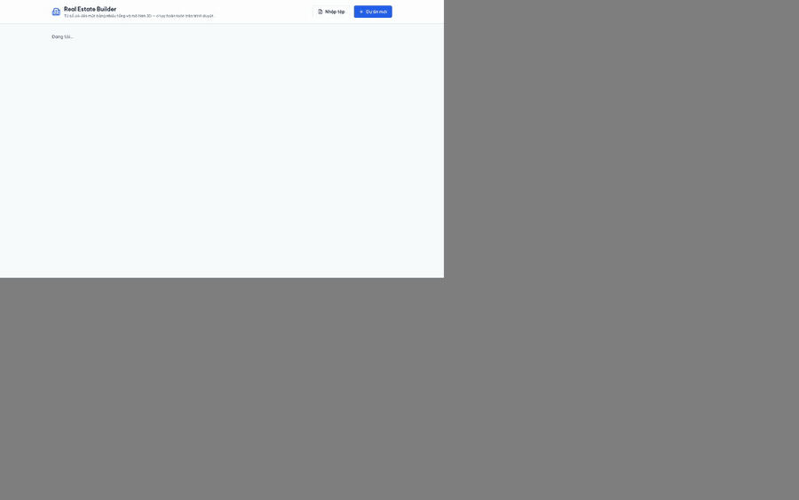

Every image below is captured by the Playwright tour in [`e2e/demo.spec.ts`](e2e/demo.spec.ts), so the README shows what the current code actually does (`pnpm demo` regenerates them). The AI step uses a canned Claude answer, so it runs without an API key.

| | Bước | Kết quả |
| --- | --- | --- |
| 1 | **Danh sách dự án** — mở app | 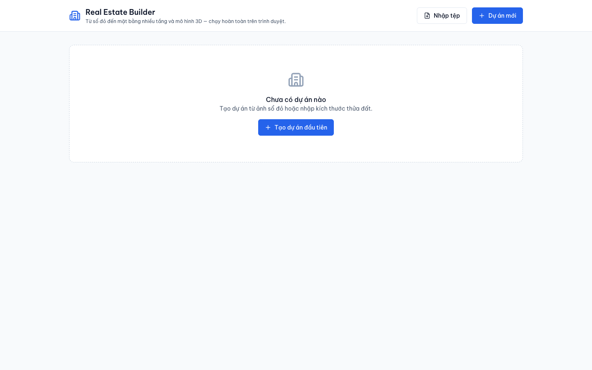 |
| 2 | **Dự án mới** — đặt tên, chọn "Nhập kích thước" (5 × 20 m) hoặc "Từ ảnh sổ đỏ" | 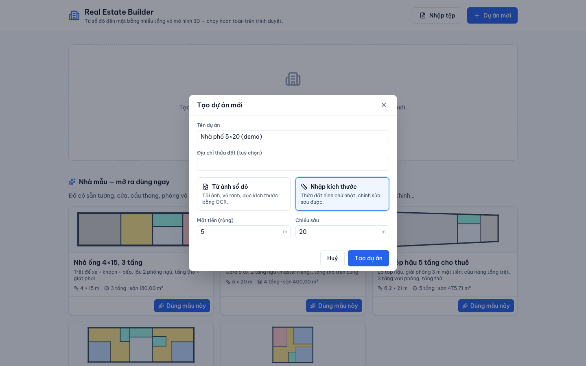 |
| 3 | **Trình dựng** — thanh công cụ có chữ, checklist "Các bước dựng nhà" ở panel phải | 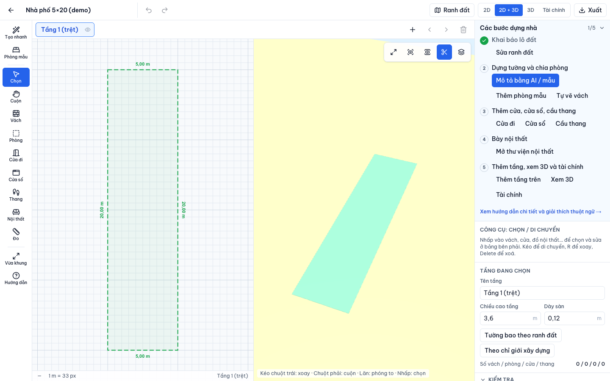 |
| 4 | **Giải phóng mặt bằng** — Ràng buộc → bật lộ giới, thu hồi 2 m ở mặt tiền; phần bị cắt tô cam, thống kê tính trên đất còn lại | 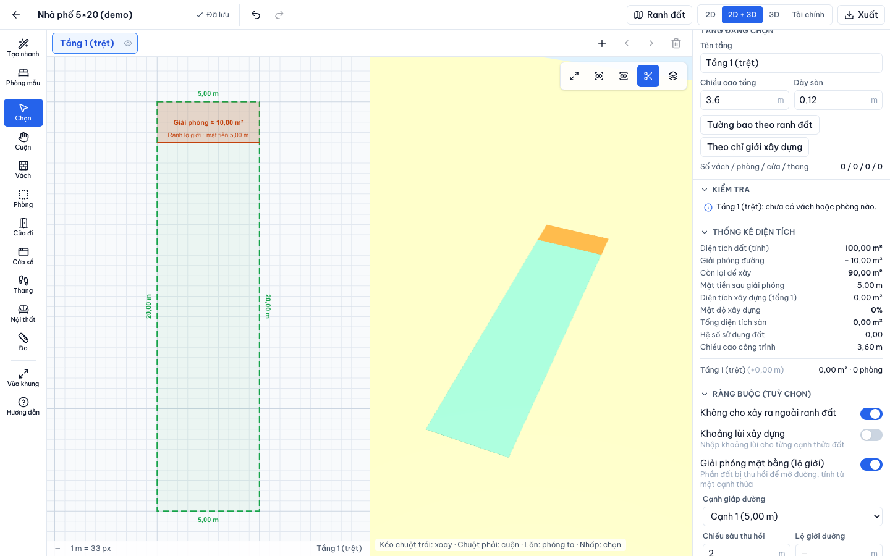 |
| 5 | **Thiết kế bằng AI** — Tạo nhanh → mô tả bằng lời (hoặc nói) → Claude trả về các phòng, lời giải thích và hình xem trước | 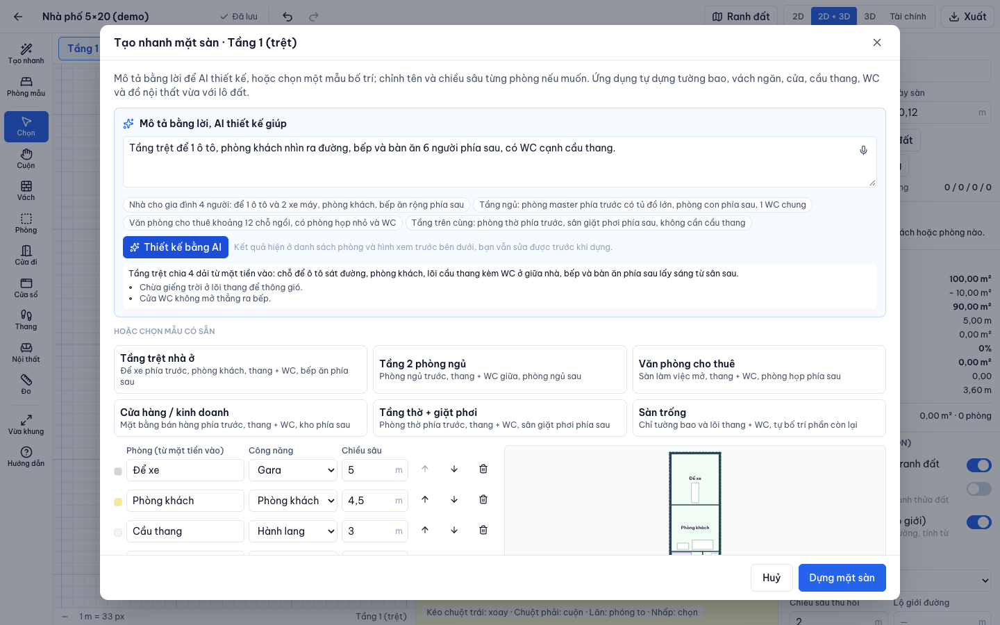 |
| 6 | **Dựng mặt sàn** — tường, cửa, cầu thang + WC, nội thất tự vừa với lô | 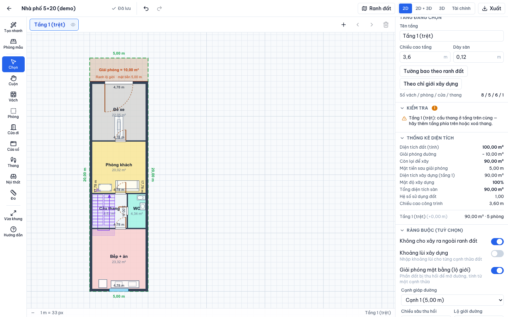 |
| 7 | **Thêm tầng từ mẫu** — "Thêm tầng trên" → mẫu "Sàn trống" (chỉ tường bao + WC) | 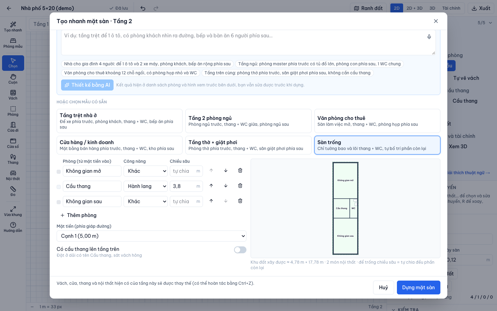 |
| 8 | **Phòng mẫu** — chọn "Phòng ngủ master": app chấm điểm các vị trí (cửa sổ ra mặt tiền/mặt sau, yên tĩnh, gần WC, giữ lối đi) và giải thích lý do | 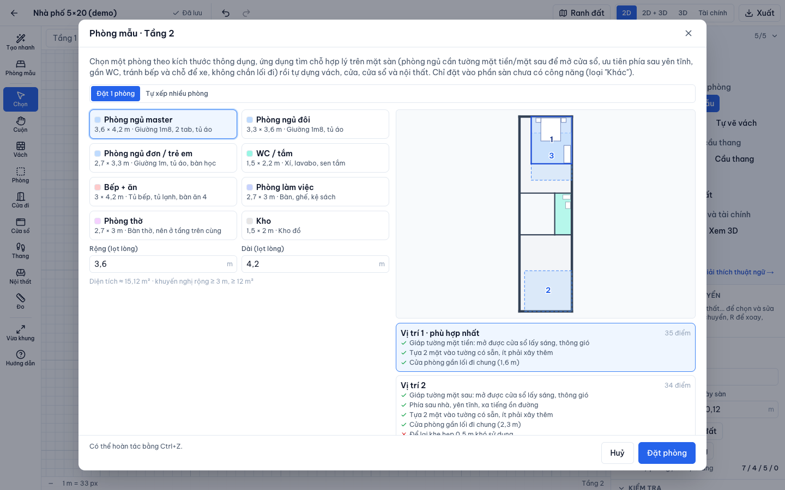 |
| 9 | **Tự xếp nhiều phòng** — chọn bộ "Master + phòng ngủ đơn + WC", app đặt lần lượt từng phòng vào chỗ tốt nhất | 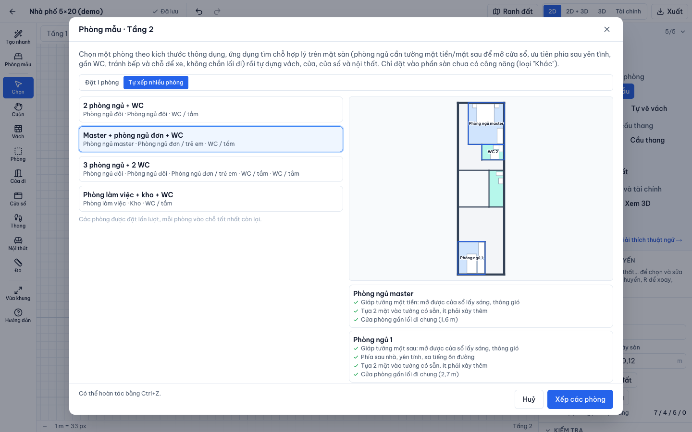 |
| 10 | **Kết quả** — vách, cửa, cửa sổ, giường, tủ, thiết bị WC được dựng sẵn | 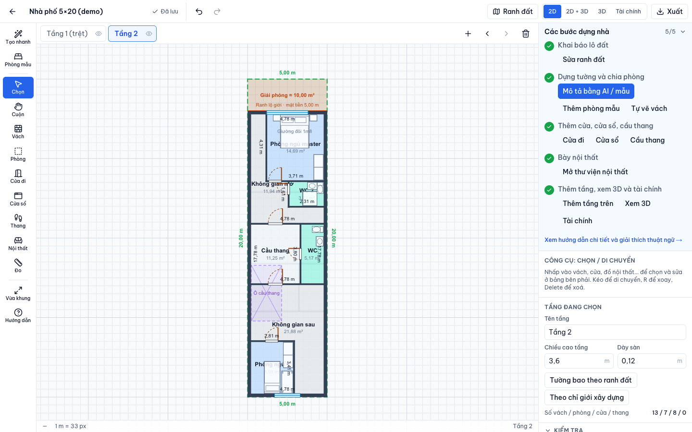 |
| 11 | **Xem 3D** — các tầng, nội thất, cầu thang | 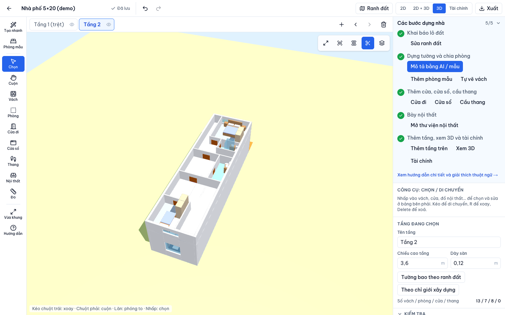 |
| 12 | **Hướng dẫn sử dụng** — giải thích từng bước và thuật ngữ | 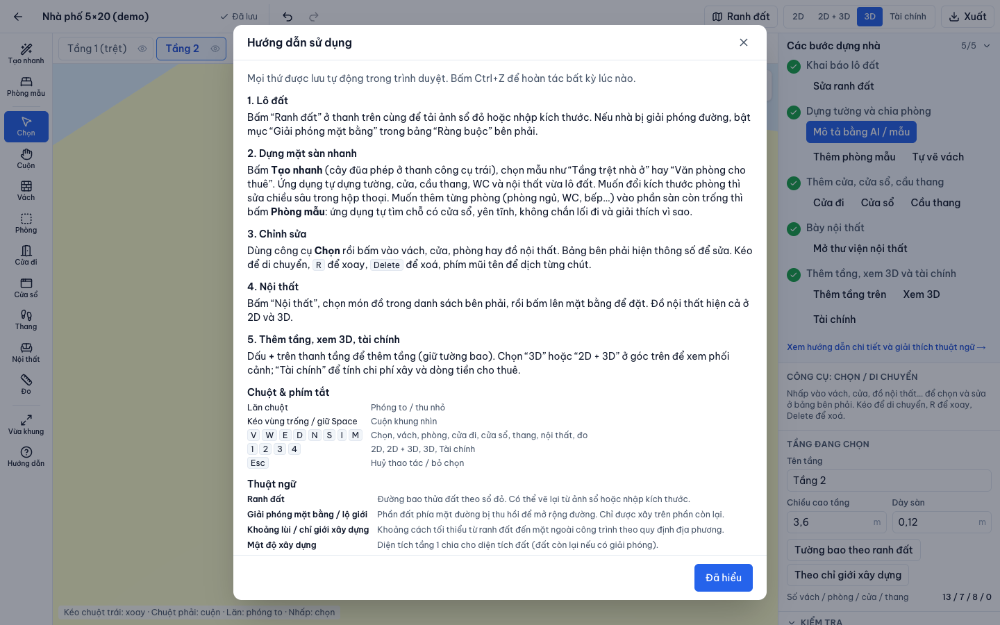 |
| 13 | **Tài chính** — diện tích quy đổi từ bản vẽ, chi phí, vay, cho thuê, dòng tiền 20 năm | 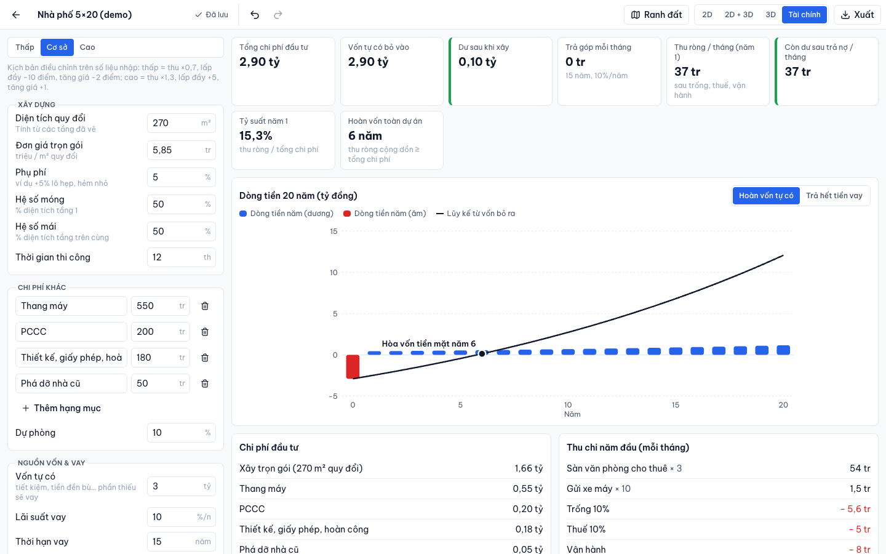 |

New user-facing features must add a step here — see [Feature showcase rule](AGENTS.md#feature-showcase-rule-every-feature-update).

## Features

**Getting started is guided:** the side panel opens with a 5-step checklist (lot → walls → doors/stairs → furniture → floors/3D/finance) with one-click actions, the left toolbar has text labels, and **Hướng dẫn** (or `?`) opens a plain-language manual with the jargon explained. **Tạo nhanh** lays out a whole townhouse floor from a template (ground floor, 2 bedrooms, office, shop, worship + laundry, open) as bands from the street to the back: walls, doors, facade window/door, a U stair with a WC beside it, and furniture, fitted to the lot, road cut and setbacks. A **furniture library** (24 pieces: living, bedroom, kitchen, bath, office, car/motorbike…) can be placed, dragged, rotated (R) and resized; each piece is one part list drawn as the 2D symbol and built as the 3D model. In 3D, the top visible floor shows 1.2 m walls (toggle) so rooms and furniture are visible.

**Phòng mẫu** (toolbar, or "Thêm phòng mẫu" in the checklist) drops standard-size rooms — master / double / single bedroom, WC, kitchen, study, worship room, storage — into the floor's free space (rooms of type "Khác"); an empty floor gets its exterior walls first. Spots are found and ranked by rules in `src/domain/roomPlacer.ts`: a bedroom must touch the front or back facade for a window (side walls usually touch the neighbours), prefers the quiet back, a WC next door and no kitchen/garage, stays off the stair and the stair well from below, and every spot must keep all doors and the stair reachable through ≥ 0.8 m passages (grid flood fill). The best three spots are shown with their reasons; "Tự xếp nhiều phòng" places a set (e.g. 2 bedrooms + WC) one after another. Walls, door, window and furniture are built for the chosen spot.

The **Tài chính** view (shortcut `4`) turns the drawn floors into a feasibility study: equivalent floor area (móng + floors + mái) × turnkey price, extra cost items, own capital vs. bank loan, rental income lines, and a 20-year cash flow with break-even / loan-payoff year under low / base / high scenarios. Money is in million VND; inputs are saved with the project.

Lots can carry a **road cut** (giải phóng mặt bằng / lộ giới): pick the edge on the road and the depth taken; the plan and 3D show the strip in orange, and coverage, FAR, exterior walls, setbacks and the "outside the lot" check all use the land that is left.

**Thiết kế bằng AI:** in the Tạo nhanh dialog the user types (or speaks — Web Speech API, vi-VN) what the floor should be. `POST /api/ai-layout` sends the brief, the usable lot size and the other floors to Claude (`claude-opus-5`, structured output validated with zod) which returns the programme as bands (rooms, depths, stair + WC core, furniture). The same generator as the templates then builds the geometry, so the result always fits the lot; the user can still edit it before building.

Everything else is client-side — there is no database; projects are stored in the user's browser. The only server code is `/api/ai-layout`, which keeps the API key off the client.

## Getting started

Requires Node ≥ 20.9 and pnpm (version pinned in `packageManager`; `corepack enable` picks it up).

```bash
pnpm install                # also copies the tesseract assets into public/tesseract
cp .env.example .env.local  # optional, see below
pnpm dev                    # http://localhost:3000
```

## Scripts

| Command | What it does |
| --- | --- |
| `pnpm dev` | Dev server |
| `pnpm build` | Production build |
| `pnpm start` | Serve the production build |
| `pnpm lint` / `pnpm typecheck` | ESLint / `tsc --noEmit` |
| `pnpm test` | Unit tests (Vitest) for geometry, domain, store, persistence, OCR parsing |
| `pnpm test:coverage` | Tests with coverage thresholds |
| `pnpm test:e2e` | Playwright feature tour (`e2e/`) against a production build on port 3217 (`E2E_PORT` to change) |
| `pnpm demo` | Same tour, but also saves the screenshots in `docs/demo/` and rebuilds `docs/demo/tour.gif` (needs ffmpeg) |

## Project layout

```
src/
  app/          routes: / (projects home), /editor, /api/ai-layout (Claude)
  features/     home, lot wizard, 2D plan, 3D viewer, finance, editor shell
  domain/       types, zod schema, factories, validation, stats, finance model
  geometry/     polygon/segment math, wall graph, snapping, openings, stairs, hit testing
  store/        Zustand stores (project + editor UI)
  persistence/  IndexedDB, autosave, import/export
  ocr/          image helpers, tesseract wrapper, dimension parsing
  components/ui shared UI primitives
e2e/            Playwright feature tour (README demo)
docs/demo/      screenshots + GIF captured by the tour
```

## Environment variables

See `.env.example`:

- `ANTHROPIC_API_KEY` (server only) — enables “Thiết kế bằng AI”. Without it the endpoint answers 503 and the rest of the app works as before.
- `AI_LAYOUT_MODEL` (optional) — overrides the model (default `claude-opus-5`).
- `NEXT_PUBLIC_BASE_PATH` (optional) — set it when the site is hosted under a sub-path so the OCR assets resolve.

## Deploy

Deployed on Vercel as a regular Next.js app (static pages + one serverless route); install/build commands are pinned in `vercel.json`. Every merge to `main` deploys production. Set `ANTHROPIC_API_KEY` in the Vercel project to turn on the AI designer.
